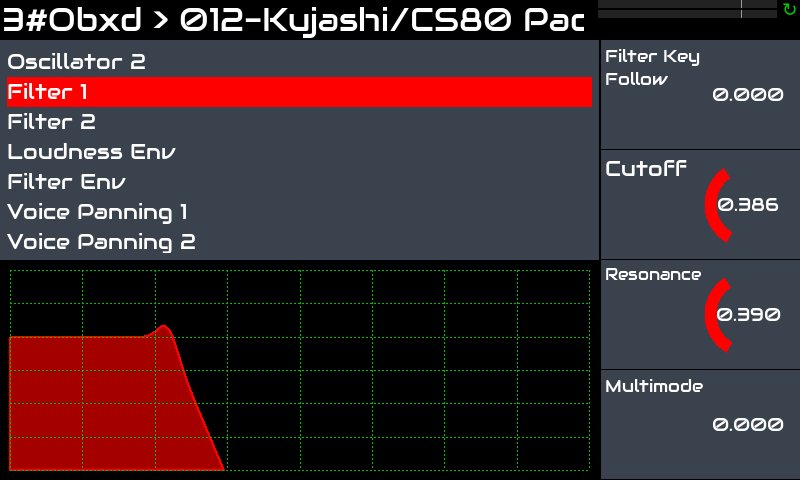
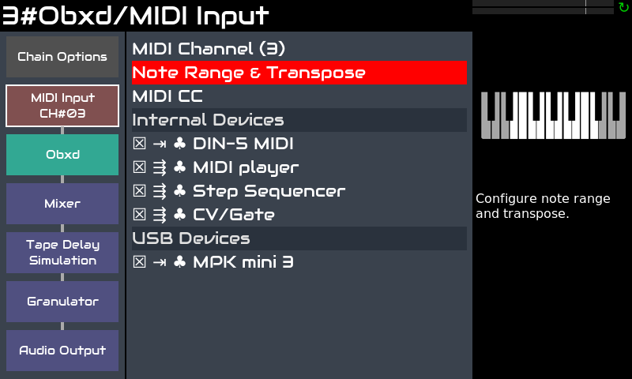
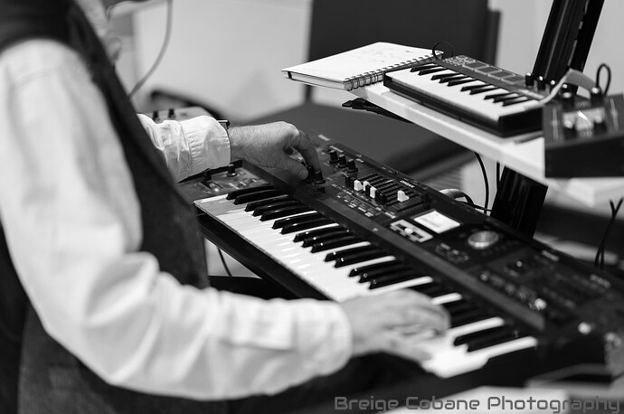

Zynthian es una gran herramienta para teclistas que quieren ampliar sus posibilidades musicales sin tener que cargar con hardware pesado y caro.

Zynthian incluye más de 30 motores de síntesis, cientos de efectos y miles de presets. Puedes tocar el estilo musical que quieras, recreando instrumentos vintage o explorando nuevos sonidos y texturas. Puedes combinar varios motores y presets, ajustar los parámetros del sintetizador y añadir efectos y filtros.

Zynthian admite el formato de plugins LV2, por lo que la lista de motores de síntesis & efectos no deja de crecer. La mayoría de los plugins disponibles son software libre, pero también hay algunos plugins comerciales disponibles, como el increíble [Pianoteq](https://www.modartt.com/pianoteq?target=_blank) modelador físico o TAL-U-NO-LX, un emulador preciso del JUNO-60. Se incluyen versiones de demostración de ambos.

Puedes combinar fácilmente varias cadenas (instrumentos) para crear sonidos en capas manteniendo el control independiente de los parámetros que quieras. Puedes transponer cada una de forma independiente y dividir el teclado como quieras. 

Cada controlador MIDI (teclado, etc.) que conectes a zynthian se puede enrutar a cualquier número de cadenas y configurar para funcionar en *activo* o *multi* modo. *Activo* es el modo predeterminado. En *activo* modo, la cadena seleccionada recibe las notas que tocas, **no importa el canal MIDI**. Por otro lado, el *multi* modo te permite **aprovecha los canales MIDI**, permitiendo que diferentes cadenas reciban diferentes canales MIDI.

Sub-snapshots (ZS3s) permiten cambios rápidos de preset y transiciones suaves entre instrumentos. Sin cortes de sonido al cambiar de instrumento. Empiezas a tocar un nuevo preset mientras las últimas notas del anterior aún se están apagando. Mantén algunas notas pulsadas o sostenidas mientras cambias a un nuevo preset y las notas seguirán sonando hasta que sueltes la tecla/pedal. 

El flujo de trabajo de MIDI-learning es rápido y sencillo, y te permite gestionarlo todo desde tus teclados/controladores.  Los botones se pueden asignar a presets (program-change), los knobs y faders, a parámetros del motor (CC).

Zynthian tiene conectores MIDI-IN/THRU/OUT estándar y 4 puertos USB ([especificaciones completas](/technical-specifications)). Puedes configurar cada teclado para tocar una cadena diferente. O dividir tu teclado y asignarle varios instrumentos. O quizá quieras que el step-sequencer controle la línea de Drum & Bass mientras tocas un lead. Las posibilidades son casi infinitas ...

¡La herramienta de configuración web te permite instalar colecciones, gestionar tus presets, soundfonts y snapshots, descargar tus grabaciones y mucho más! También puedes configurar tu zynthian para controlarlo por completo desde tu teclado. Cada acción de la UI se puede asignar a eventos MIDI.

En cuanto a latency y jitter, la configuración predeterminada (<10ms) es suficiente para la mayoría de los músicos, pero si buscas una latency ultrabaja, se puede ajustar la configuración de audio.
