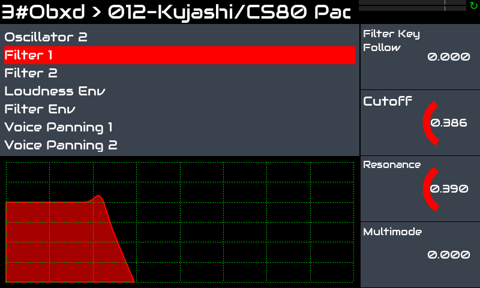
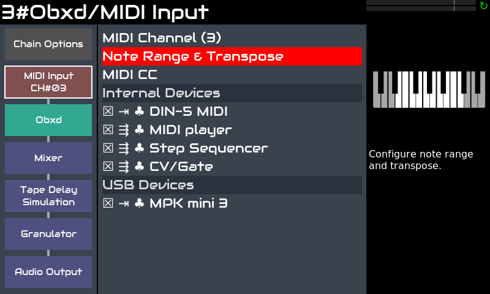
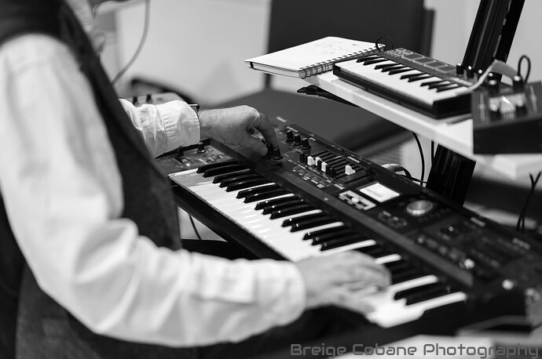

Zynthian est un excellent outil pour les claviéristes souhaitant élargir leurs possibilités de jeu sans avoir à transporter du matériel lourd et coûteux.

Zynthian comprend plus de 30 moteurs de synthèse, des centaines d'effets et des milliers de presets. Vous pouvez jouer le style de musique que vous voulez, en recréant des instruments vintage ou en explorant de nouveaux sons et textures. Vous pouvez combiner plusieurs moteurs et presets, ajuster les paramètres de synthèse et ajouter des effets et des filtres.

Zynthian prend en charge le format de plugins LV2, la liste des moteurs de synthèse & des effets ne cesse donc de s'allonger. La plupart des plugins disponibles sont des logiciels libres, mais certains plugins commerciaux sont disponibles, comme l'incroyable [Pianoteq](https://www.modartt.com/pianoteq?target=_blank) modélisateur physique ou TAL-U-NO-LX, un émulateur fidèle du JUNO-60. Des versions de démonstration sont incluses pour les deux.

Vous pouvez facilement combiner plusieurs chaînes (instruments) pour créer des sons superposés tout en gardant un contrôle indépendant sur les paramètres de votre choix. Vous pouvez transposer chacune indépendamment et diviser le clavier comme vous le souhaitez. 

Chaque contrôleur MIDI (clavier, etc.) que vous connectez à zynthian peut être routé vers un nombre quelconque de chaînes et configuré pour fonctionner en *actif* ou *multi* mode. *Actif* est le mode par défaut. Dans *actif* mode, la chaîne sélectionnée reçoit les notes que vous jouez, **quel que soit le canal MIDI**. D'un autre côté, le *multi* mode vous permet de **tirez parti des canaux MIDI**, permettant à différentes chaînes de recevoir différents canaux MIDI.

Les Sub-snapshots (ZS3s) permettent des changements rapides de preset et des transitions fluides entre les instruments. Aucune coupure du son lors du changement d'instrument. Vous commencez à jouer un nouveau preset alors que les dernières notes de l'ancien continuent de s'estomper. Maintenez certaines notes enfoncées ou prolongées avec la pédale tout en passant à un nouveau preset et les notes continueront de sonner jusqu'à ce que vous relâchiez la touche/pédale. 

Le workflow MIDI-learning est rapide et facile, vous permettant de tout gérer depuis vos claviers/contrôleurs.  Les boutons peuvent être assignés aux presets (program-change), les knobs et faders, aux paramètres du moteur (CC).

Zynthian dispose de connecteurs MIDI-IN/THRU/OUT standard et de 4 ports USB ([spécifications complètes](/technical-specifications)). Vous pouvez configurer chaque clavier pour jouer une chaîne différente. Ou diviser votre clavier et y assigner plusieurs instruments. Ou encore utiliser le step-sequencer pour contrôler la ligne Drum & Bass pendant que vous jouez un lead. Les possibilités sont presque infinies ...

L'outil de configuration web vous permet d'installer des collections, de gérer vos presets, soundfonts et snapshots, de télécharger vos enregistrements et bien plus encore! Vous pouvez également configurer votre zynthian pour le contrôler entièrement depuis votre clavier. Chaque action de l'interface utilisateur peut être assignée à des événements MIDI.

Concernant la Latency et le Jitter, la configuration par défaut (<10ms) suffit à la plupart des musiciens, mais si vous recherchez une Latency extrêmement faible, la configuration audio peut être ajustée.
