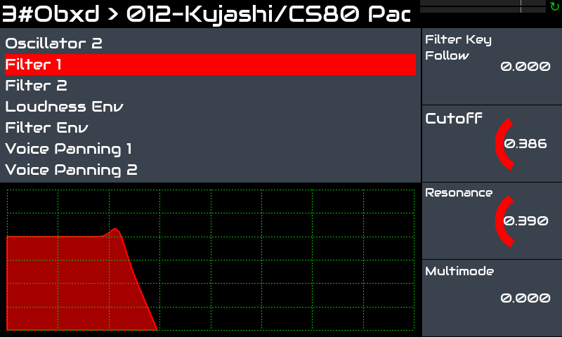
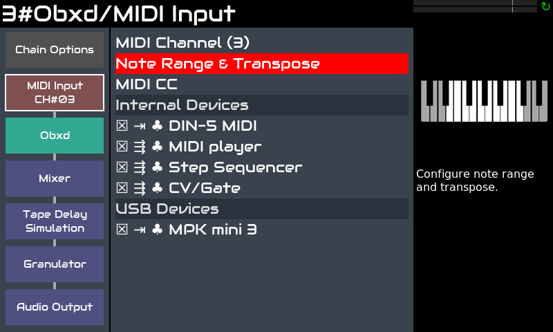
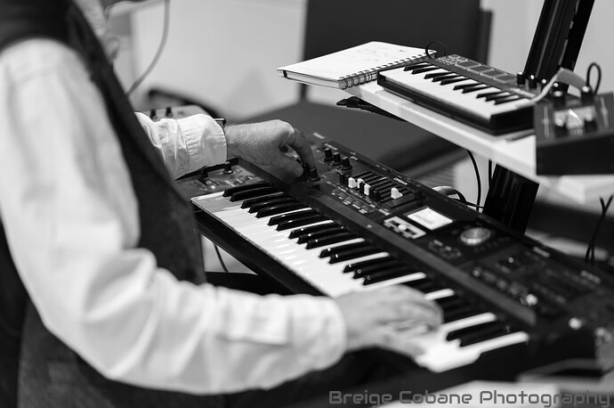

Zynthian è un ottimo strumento per i tastieristi che desiderano ampliare le proprie possibilità esecutive senza dover trasportare hardware pesante e costoso.

Zynthian include più di 30 motori di sintesi, centinaia di effetti e migliaia di preset. Puoi suonare lo stile musicale che vuoi, ricreando strumenti vintage o esplorando nuovi suoni e texture. Puoi combinare diversi motori e preset, regolare i parametri del synth e aggiungere effetti e filtri.

Zynthian supporta il formato plugin LV2, quindi la lista di motori di sintesi & effetti è in continua crescita. La maggior parte dei plugin disponibili è software libero, ma sono disponibili anche alcuni plugin commerciali, come lo straordinario [Pianoteq](https://www.modartt.com/pianoteq?target=_blank) physical modeller o TAL-U-NO-LX, un accurato emulatore del JUNO-60. Sono incluse versioni demo per entrambi.

Puoi combinare facilmente più catene (strumenti) per creare suoni stratificati mantenendo il controllo indipendente sui parametri desiderati. Puoi trasporre ciascuna di esse in modo indipendente e suddividere la tastiera come preferisci. 

Ogni controller MIDI (tastiera, ecc.) che colleghi a zynthian può essere instradato verso un numero qualsiasi di catene e configurato per funzionare in *attivo* o *multi* modalità. *Attivo* è la modalità predefinita. In *attivo* modalità, la catena selezionata riceve le note che suoni, **non importa il canale MIDI**. D'altra parte, il *multi* la modalità ti consente di **sfrutta i canali MIDI**, consentendo a catene diverse di ricevere canali MIDI diversi.

I Sub-snapshots (ZS3s) consentono cambi di preset rapidi e transizioni fluide tra gli strumenti. Nessuna interruzione del suono quando si cambia strumento. Puoi iniziare a suonare un nuovo preset mentre le ultime note di quello precedente sono ancora in fase di rilascio. Tieni premute o sostenute alcune note mentre passi a un nuovo preset e le note continueranno a suonare finché non rilasci il tasto/pedale. 

Il workflow MIDI-learning è rapido e semplice e ti consente di gestire tutto dalle tue tastiere/controller.  I pulsanti possono essere assegnati ai preset (program-change), knob e fader, ai parametri del motore (CC).

Zynthian dispone di connettori standard MIDI-IN/THRU/OUT e 4 porte USB ([specifiche complete](/technical-specifications)). Puoi configurare ogni tastiera per suonare una catena diversa. Oppure dividere la tua tastiera e mapparvi diversi strumenti. Oppure potresti volere che lo step-sequencer controlli la linea Drum & Bass mentre suoni un lead. Le possibilità sono quasi infinite ...

Lo strumento di configurazione web ti consente di installare raccolte, gestire i tuoi preset, soundfont e snapshot, scaricare le tue registrazioni e molto altro! Puoi anche configurare il tuo zynthian per controllarlo completamente dalla tua tastiera. Ogni azione dell'interfaccia utente può essere mappata a eventi MIDI.

Per quanto riguarda latency e jitter, la configurazione predefinita (<10ms) è sufficiente per la maggior parte dei musicisti, ma se cerchi una latency estremamente bassa, la configurazione audio può essere ottimizzata.
