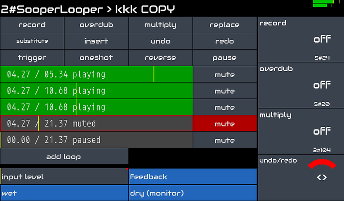

Zynthian kann als leistungsstarke Audio Effects-Einheit verwendet werden, die die Erstellung einer individuellen effect-chain für jeden verfügbaren Audioeingang ermöglicht.

Das offizielle Zynthian V5 Kit hat 2 symmetrische Audio-Eingänge mit unabhängiger Gain-Regelung im Bereich von -12db bis +32dB. Lesen Sie die vollständigen Spezifikationen [hier](/technical-specifications). Du kannst eine breite Palette von Eingabegeräten direkt anschließen, wie dynamische Mikrofone, elektrische & akustische Gitarren, Piezos, Line-in, usw. Wenn du mehr Audioeingänge benötigst, schließt du einfach dein bevorzugtes USB-Audio-Interface an und erhältst alle zusätzlichen Audio-Eingangs-/Ausgangskanäle, die du benötigst.

Zynthian unterstützt den LV2-Plugin-Standard und enthält Hunderte von Plugins zur Audioverarbeitung. Du kannst sie nach Belieben kombinieren, um den Klang zu formen, Vintage-Klanglandschaften nachzubilden oder neue Texturen zu erkunden. Du kannst beliebig viele FX-Chains mit flexiblem Routing nutzen, das eine beliebig einfache oder komplexe Konfiguration ermöglicht.

Wenn du ein Gitarrentyp bist, werden dir die in zynthian enthaltenen Neural Modelers gefallen:

+ [NAM](/engines/_engine-list/engine-nam)
+ [Ratatouille](/engines/_engine-list/engine-ratatouille)
+ [Aida-X](/engines/_engine-list/engine-aidax)
+ [Neural Rack](/engines/_engine-list/engine-neuralrack)

Sie bieten hochmoderne, präzise Emulationen von analogem Equipment wie Verstärkern, Distortion-, Fuzz- und Overdrive-Stompboxen, etc. Buchstäblich Tausende von Modellen sind frei verfügbar bei [Tone3000](https://tone3000.com), das vollständig in zynthian integriert ist. Wähle ein Modell für dein Lieblingsequipment und erhalte mit wenigen Klicks den Sound, den du liebst.

Wenn du Looping magst, ist SooperLooper vollständig integriert und ermöglicht die Steuerung von bis zu 6 unabhängigen Loops mit sofortigem Record, Overdub, Reverse, Multiply, Replace, Time-Stretch, Pitch-Shift und vielem mehr.

Der MIDI-learning-Workflow ist schnell und einfach. Sie können die gewünschten Parameter über Ihren bevorzugten MIDI-Controller einstellen. Tasten können Presets (program-change) zugewiesen werden, und Knobs und Fader können Parametern zugewiesen werden (CC).

Was Latency und Jitter betrifft, reicht die Standardkonfiguration (<10ms) für die meisten Musiker aus, aber wenn Sie eine besonders niedrige Latency wünschen, kann die Audiokonfiguration angepasst werden.
