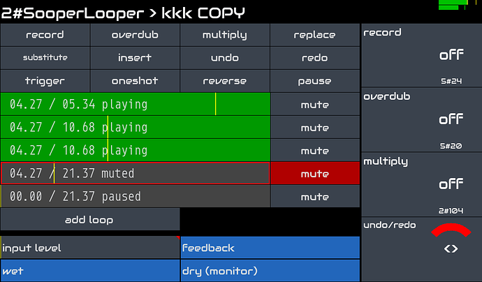

Zynthian peut être utilisé comme un puissant processeur d'effets audio permettant de créer une chaîne d'effets personnalisée pour chaque entrée audio disponible.

Le kit officiel Zynthian V5 dispose de 2 entrées audio symétriques avec un contrôle de Gain indépendant allant de -12db à +32dB. Consultez les spécifications complètes [ici](/technical-specifications). Vous pouvez connecter directement une large gamme de périphériques d'entrée, comme des microphones dynamiques, des guitares électriques & acoustiques, des piezos, line-in, etc. Si vous avez besoin de davantage d'entrées audio, il vous suffit de connecter votre interface audio USB préférée pour disposer de tous les canaux d'entrée/sortie audio supplémentaires dont vous avez besoin.

Zynthian prend en charge le standard LV2-plugin et inclut des centaines de plugins de traitement audio. Vous pouvez les combiner à votre guise pour sculpter le son, recréer des paysages vintage ou explorer de nouvelles textures. Vous pouvez disposer d'un nombre quelconque de FX-chains avec un routage flexible permettant une configuration aussi simple ou complexe que vous le souhaitez.

Si vous êtes un amateur de guitare, vous apprécierez les modélisateurs neuronaux inclus avec zynthian:

+ [NAM](/engines/_engine-list/engine-nam)
+ [Ratatouille](/engines/_engine-list/engine-ratatouille)
+ [Aida-X](/engines/_engine-list/engine-aidax)
+ [Neural Rack](/engines/_engine-list/engine-neuralrack)

Ils offrent une émulation de pointe et fidèle de matériel analogique comme des amplificateurs, des pédales de distortion, fuzz, overdrive, etc. Des milliers de modèles sont disponibles gratuitement sur [Tone3000](https://tone3000.com), qui est entièrement intégré à zynthian. Choisissez un modèle pour votre équipement préféré et obtenez le son que vous aimez en quelques clics.

Si vous aimez le looping, SooperLooper est entièrement intégré, permettant de contrôler jusqu'à 6 boucles indépendantes avec record, overdub, reverse, multiply, replace, time-stretch, pitch-shift instantanés, et bien plus encore.

Le flux de travail MIDI-learning est rapide et simple. Vous pouvez ajuster les paramètres souhaités depuis votre contrôleur MIDI préféré. Les boutons peuvent être assignés aux presets (program-change), et les Knobs et Faders aux paramètres (CC).

Concernant la Latency et le Jitter, la configuration par défaut (<10ms) suffit à la plupart des musiciens, mais si vous recherchez une Latency extrêmement faible, la configuration audio peut être ajustée.
