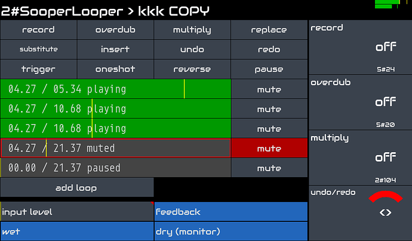

Zynthian può essere utilizzato come una potente unità di effetti audio che consente di creare una catena di effetti personalizzata per ogni ingresso audio disponibile.

Il Kit ufficiale Zynthian V5 dispone di 2 ingressi audio bilanciati con controllo indipendente del Gain da -12db a +32dB. Leggi le specifiche complete [qui](/technical-specifications). Puoi collegare direttamente un'ampia gamma di dispositivi di ingresso, come microfoni dinamici, chitarre elettriche & acustiche, piezo, line-in, ecc. Se hai bisogno di più ingressi audio, ti basta collegare la tua interfaccia audio USB preferita per ottenere tutti i canali di ingresso/uscita audio aggiuntivi di cui hai bisogno.

Zynthian supporta lo standard LV2-plugin e include centinaia di plugin per l'elaborazione audio. Puoi combinarli come preferisci per scolpire il suono, ricreare paesaggi vintage o esplorare nuove texture. Puoi avere un numero qualsiasi di FX-chains con routing flessibile che consente configurazioni semplici o complesse quanto desideri.

Se sei un appassionato di chitarra, apprezzerai i modeler neurali inclusi in zynthian:

+ [NAM](/engines/_engine-list/engine-nam)
+ [Ratatouille](/engines/_engine-list/engine-ratatouille)
+ [Aida-X](/engines/_engine-list/engine-aidax)
+ [Neural Rack](/engines/_engine-list/engine-neuralrack)

Offrono un'emulazione accurata e all'avanguardia di apparecchiature analogiche come amplificatori, distortion, fuzz, overdrive stomp-boxes, ecc. Sono disponibili gratuitamente letteralmente migliaia di modelli su [Tone3000](https://tone3000.com), che è completamente integrato con zynthian. Scegli un modello per la tua strumentazione preferita e ottieni il suono che ami con pochi clic.

Se ti piace il looping, SooperLooper è completamente integrato, consentendo di controllare fino a 6 loop indipendenti con record, overdub, reverse, multiply, replace, time-stretch, pitch-shift istantanei, e molto altro.

Il workflow di MIDI-learning è rapido e semplice. Puoi regolare i parametri che desideri dal tuo controller MIDI preferito. I pulsanti possono essere assegnati ai preset (program-change), e i Knob e i Fader ai parametri (CC).

Per quanto riguarda latency e jitter, la configurazione predefinita (<10ms) è sufficiente per la maggior parte dei musicisti, ma se cerchi una latency estremamente bassa, la configurazione audio può essere ottimizzata.
