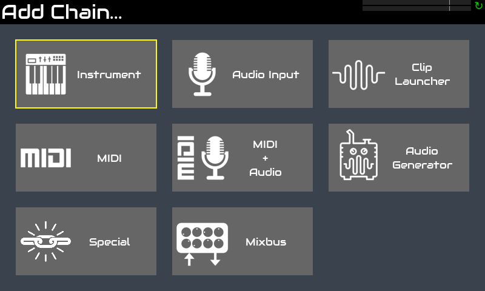
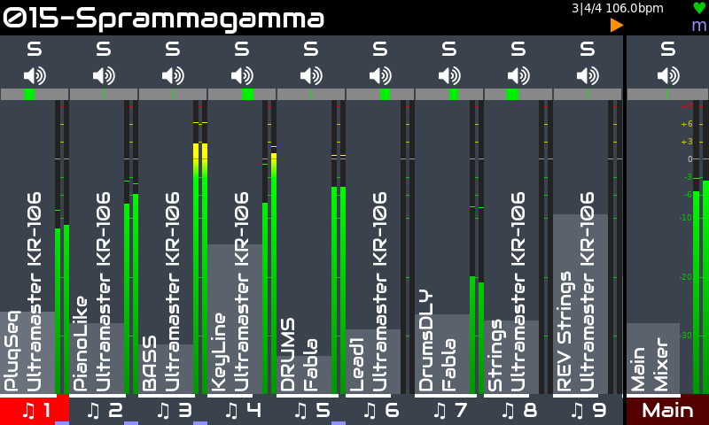
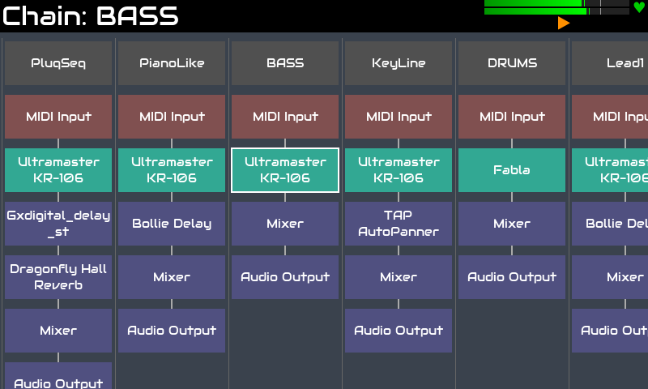
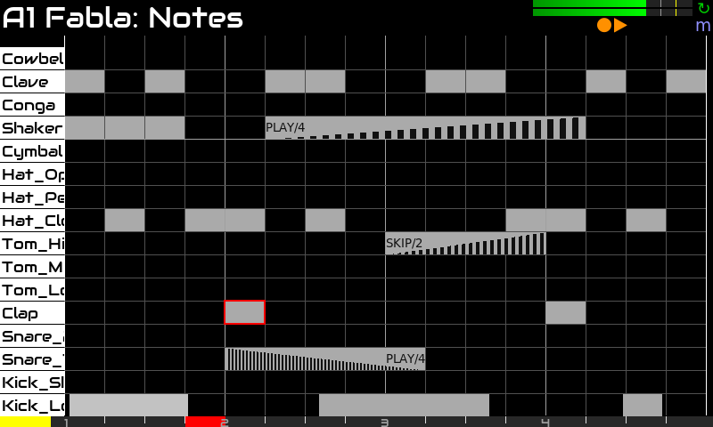
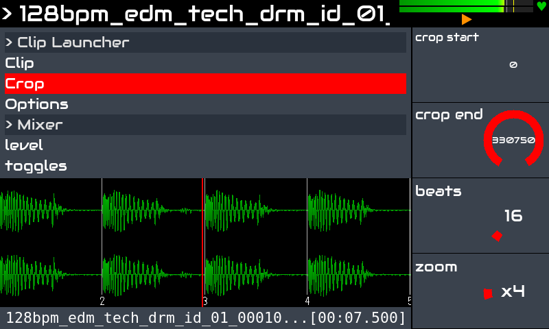
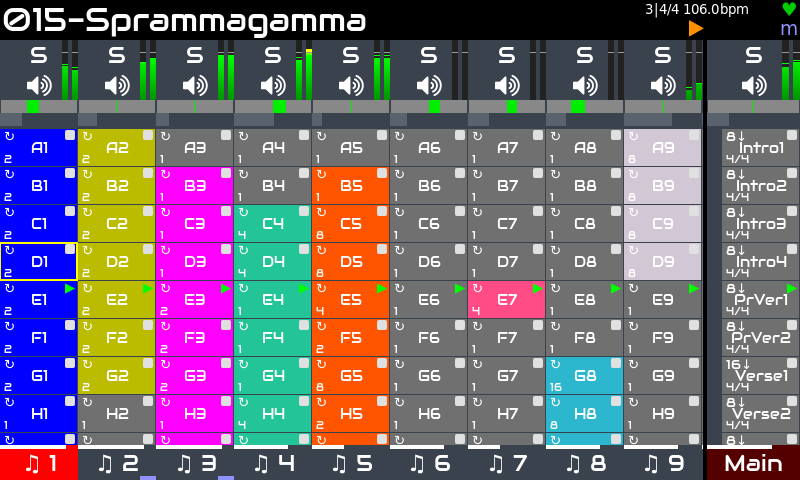

Zynthian también es una potente herramienta de producción. Incluye más de 100 motores de síntesis y miles de presets y más de 1000 efectos de audio & MIDI.

Es completamente multitímbrico, capaz de gestionar hasta 16 cadenas de instrumentos y cualquier número de efectos de audio, procesadores midi y mixbuses. Es compatible con el estándar LV2-plugin, por lo que la lista de procesadores disponibles es enorme y sigue creciendo.

Incluye un potente step-sequencer con funciones para tocar en directo y componer canciones:

+ alta resolución (1920 ppqn)
+ editor de patrones (eventos & bloques)
+ copiar/pegar & transponer bloques
+ copiar/pegar patrones
+ captura en directo
+ deshacer/rehacer
+ opciones avanzadas de stutter:  speed, duration, volume-fade, speed-ramp
+ opciones de repetición & aleatorización: probabilidad de reproducción/omisión, frecuencia de reproducción/omisión, etc. 
+ automatización de parámetros
+ mucho más!

También incluye un reproductor avanzado de clips de audio capaz de cargar cualquier formato de archivo de audio, aplicar time-stretch y sincronizar samples de audio, etc.

La vista launcher permite combinar patrones del step sequencer y clips de audio, iniciándolos y deteniéndolos de forma sincronizada, con diferentes modos  para una sola reproducción, loops, etc. Phrases te permite estructurar tus canciones, automatizando los cambios de tempo & time signature, definiendo loops y secciones CODA, etc.

Una lista cada vez mayor de controladores midi compatibles se puede utilizar para controlar zynthian directamente, totalmente plug & play:

+ **Novation:** LaunchPad Mini / Pro / X. LaunchKey Mini, etc.
+ **Akai:** APC Key-25, APC 40, MPK mini, MIDI Mix
+ **Korg:** nanoKONTROL
+ **Behringer:** Motör 61 / 49
+ **Arturia:** Keylab 61
+ **Teenage Engeneering:** OP1
+ **Worlde:** Mini
+ **Foxtex:** Mixtab
+ **Mackie (MCU)**

[Haz clic aquí](https://wiki.zynthian.org/index.php/Supported_MIDI_controllers) para consultar la lista completa de controladores MIDI compatibles.

Zynthian también se puede controlar desde DAWs y secuenciadores externos. Tiene muchas opciones de conexión:

+ conectores MIDI DIN-5 tradicionales (IN / OUT / THRU)
+ 4 x puertos USB-A (host)
+ 1 x puertos USB-B (dispositivo)
+ Conectividad de red Ethernet y WIFI

y también admite los protocolos de red MIDI más utilizados, como:

+ NetUMP (MIDI 2.0)
+ RTP (Apple MIDI)
+ QMidiNet (IP-multicast)
+ TouchOSC (tableta como controlador MIDI)

Y hay mucho más:

+ midi-learning fácil con rango de valores y escalado
+ enrutamiento flexible de audio & midi
+ mixbuses
+ grabadora de audio multipista
+ grabador y reproductor midi
+ midi-filter basado en reglas
+ patches de PureData & Organelle
+ Integración de MOD-UI

En cuanto a latency y jitter, la configuración predeterminada (<10ms) es suficiente para la mayoría de los músicos, pero si buscas una latency ultrabaja, se puede ajustar la configuración de audio.

<!--
<small>Trip Jazz Demo, by Humi</small>

<small>BlueBox is Roughly Great, by Nicolaz</small>

<small>RTPMidi Celebration, by JTunes</small>

<small>Epic EnteR, by R.Generalov</small>

<small>Electro, by Humi</small>

<small>Mr Tchaikovsky, by sm7x7</small>

<small>Of Course My Lord, by R.Generalov</small>

<small>First Real Synth, by Can Trell</small>

<small>For Wyleu, by Humi</small>

-->

