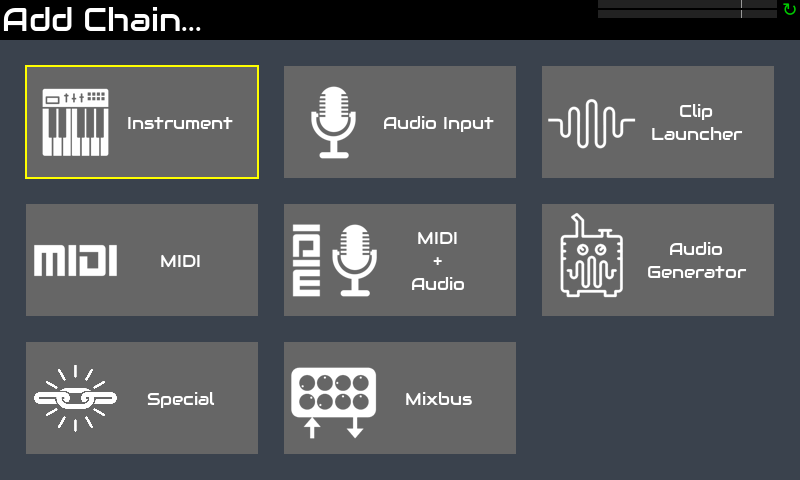
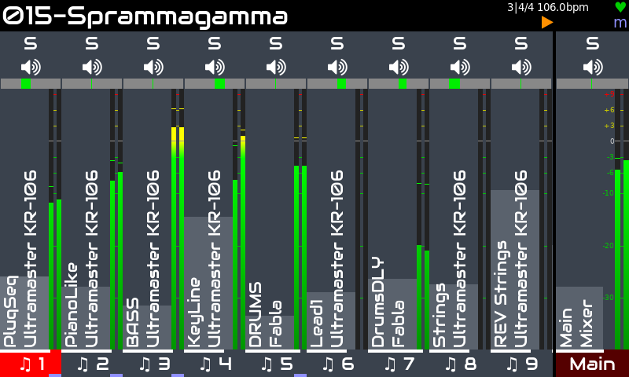
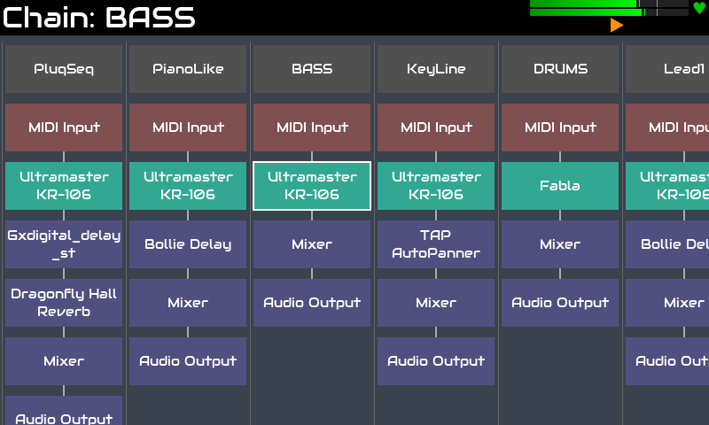
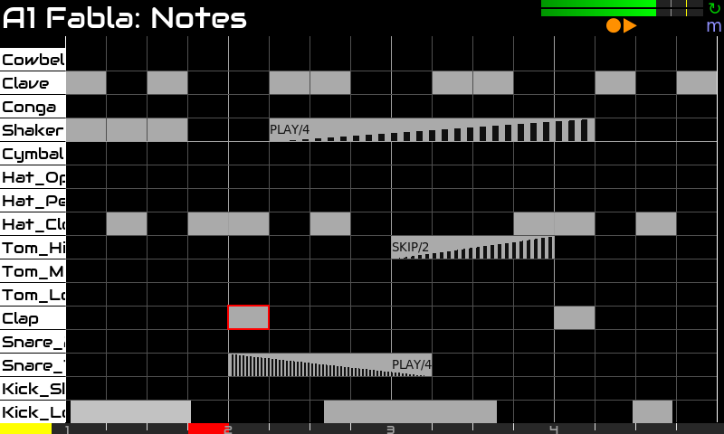
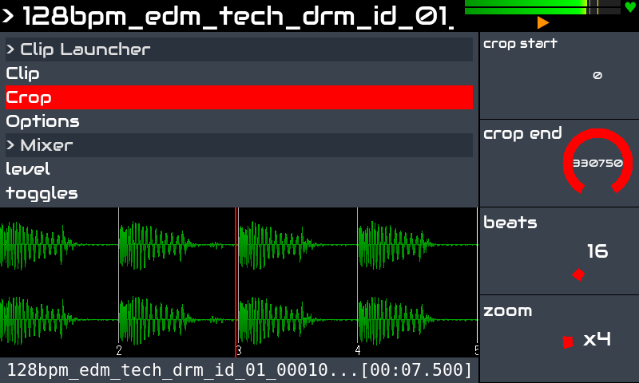
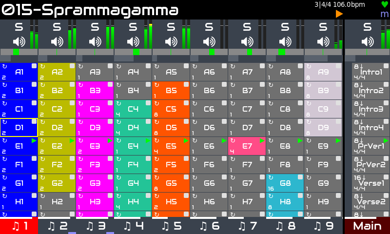

Zynthian est également un outil puissant pour la production. Il comprend plus de 100 moteurs de synthèse avec des milliers de presets et plus de 1000 effets audio & MIDI.

Il est entièrement multitimbral, capable de gérer jusqu'à 16 chaînes d'instruments et un nombre quelconque d'effets audio, de processeurs midi et de bus de mixage. Il prend en charge le standard LV2-plugin, la liste des processeurs disponibles est donc immense et ne cesse de s'allonger.

Il intègre un puissant step-sequencer avec des fonctionnalités de jeu en direct et de composition de morceaux:

+ haute résolution (1920 ppqn)
+ éditeur de patterns (événements & blocs)
+ copier/coller & transposer des blocs
+ copier/coller des patterns
+ capture en direct
+ annuler/rétablir
+ options avancées de stutter:  speed, duration, volume-fade, speed-ramp
+ options de répétition et de randomisation: probabilité de lecture/saut, fréquence de lecture/saut, etc. 
+ automation des paramètres
+ beaucoup plus!

Il intègre également un lecteur de clips audio avancé capable de charger n’importe quel format de fichier audio, d’effectuer du time-stretch et de synchroniser des samples audio, etc.

La vue launcher permet de combiner des patterns de step sequencer et des clips audio, de les démarrer et de les arrêter de manière synchronisée, en proposant différents modes  pour la lecture unique, les boucles, etc. Phrases vous permet de structurer vos morceaux, en automatisant les changements de tempo & de signature rythmique, en définissant des boucles et des sections CODA, etc.

Une liste toujours plus longue de contrôleurs midi pris en charge permet de contrôler zynthian dès le départ, entièrement plug & play:

+ **Novation:** LaunchPad Mini / Pro / X. LaunchKey Mini, etc.
+ **Akai:** APC Key-25, APC 40, MPK mini, MIDI Mix
+ **Korg:** nanoKONTROL
+ **Behringer:** Motör 61 / 49
+ **Arturia:** Keylab 61
+ **Teenage Engeneering:** OP1
+ **Worlde:** Mini
+ **Foxtex:** Mixtab
+ **Mackie (MCU)**

[Cliquez ici](https://wiki.zynthian.org/index.php/Supported_MIDI_controllers) pour consulter la liste complète des contrôleurs MIDI pris en charge.

Zynthian peut également être contrôlé depuis des DAWs et des séquenceurs externes. Il offre de nombreuses options de connexion:

+ connecteurs MIDI DIN-5 traditionnels (IN / OUT / THRU)
+ 4 x ports USB-A (hôte)
+ 1 x ports USB-B (périphérique)
+ Connectivité réseau Ethernet et WIFI

et il prend également en charge les protocoles réseau MIDI les plus couramment utilisés, comme:

+ NetUMP (MIDI 2.0)
+ RTP (Apple MIDI)
+ QMidiNet (IP-multicast)
+ TouchOSC (tablette comme contrôleur MIDI)

Et il y a bien plus encore:

+ midi-learning facile avec plage de valeurs et mise à l'échelle
+ routage audio & midi flexible
+ mixbuses
+ enregistreur audio multipiste
+ enregistreur et lecteur midi
+ midi-filter basé sur des règles
+ Patches PureData & Organelle
+ Intégration MOD-UI

Concernant la latency et le jitter, la configuration par défaut (<10ms) suffit à la plupart des musiciens, mais si vous recherchez une latency extrêmement faible, la configuration audio peut être ajustée.

<!--
<small>Trip Jazz Demo, by Humi</small>

<small>BlueBox is Roughly Great, by Nicolaz</small>

<small>RTPMidi Celebration, by JTunes</small>

<small>Epic EnteR, by R.Generalov</small>

<small>Electro, by Humi</small>

<small>Mr Tchaikovsky, by sm7x7</small>

<small>Of Course My Lord, by R.Generalov</small>

<small>First Real Synth, by Can Trell</small>

<small>For Wyleu, by Humi</small>

-->

