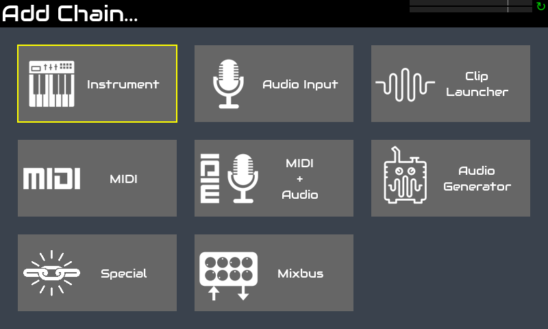
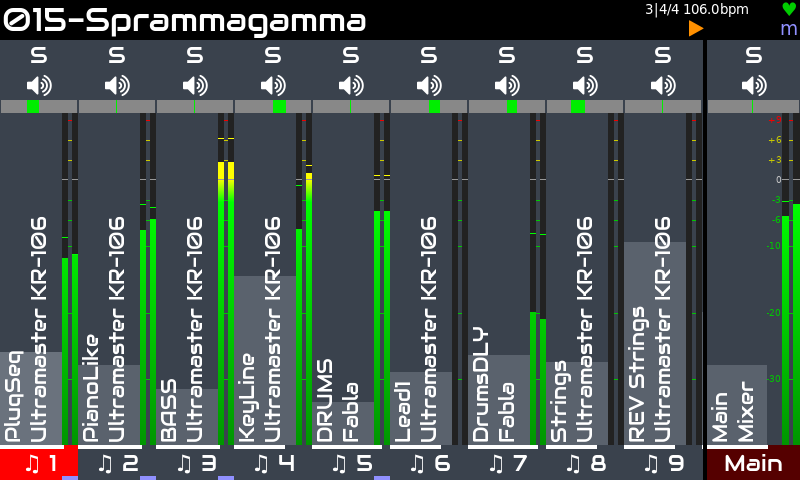
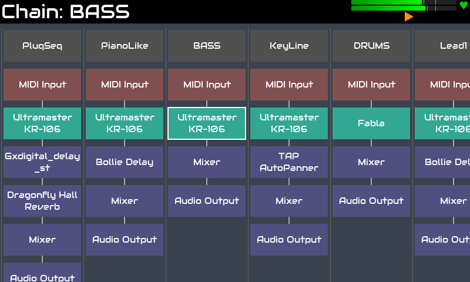
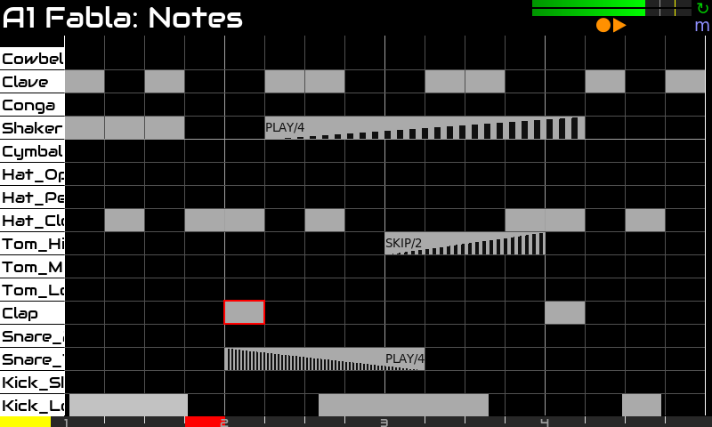
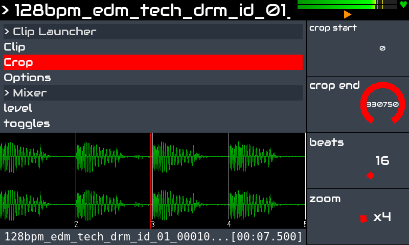
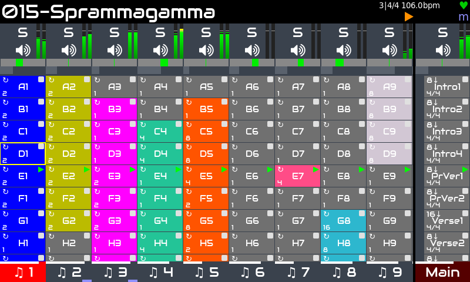

Zynthian è anche un potente strumento per la produzione. Include più di 100 synth-engine con migliaia di preset e oltre 1000 effetti audio & MIDI.

È completamente multitimbrico, in grado di gestire fino a 16 catene di strumenti e un numero qualsiasi di effetti audio, processori midi e mixbus. Supporta lo standard LV2-plugin, quindi l'elenco dei processori disponibili è vastissimo e in continua crescita.

Dispone di un potente step-sequencer con funzionalità per l'esecuzione dal vivo e la composizione di brani:

+ alta risoluzione (1920 ppqn)
+ editor di pattern (eventi & blocchi)
+ copia/incolla & trasponi blocchi
+ copia/incolla pattern
+ live capture
+ annulla/ripristina
+ opzioni avanzate di stutter:  velocità, durata, volume-fade, speed-ramp
+ opzioni di ripetizione e randomizzazione: probabilità di riproduzione/salto, frequenza di riproduzione/salto, ecc. 
+ automazione dei parametri
+ molto di più!

Include anche un lettore avanzato di clip audio in grado di caricare qualsiasi formato di file audio, applicare time-stretch e sincronizzare Samples audio, ecc.

La vista launcher consente di combinare pattern dello step sequencer e clip audio, avviandoli e fermandoli in modo sincronizzato, con diverse modalità  per la riproduzione singola, i loop, ecc. Le frasi consentono di strutturare i brani, automatizzando i cambi di tempo & indicazione metrica, definendo loop e sezioni CODA, ecc.

Un elenco in continua crescita di controller midi supportati può essere utilizzato per controllare zynthian fin da subito, in modo totalmente plug & play:

+ **Novation:** LaunchPad Mini / Pro / X. LaunchKey Mini, ecc.
+ **Akai:** APC Key-25, APC 40, MPK mini, MIDI Mix
+ **Korg:** nanoKONTROL
+ **Behringer:** Motör 61 / 49
+ **Arturia:** Keylab 61
+ **Teenage Engeneering:** OP1
+ **Worlde:** Mini
+ **Foxtex:** Mixtab
+ **Mackie (MCU)**

[Fai clic qui](https://wiki.zynthian.org/index.php/Supported_MIDI_controllers) per consultare l'elenco completo dei controller MIDI supportati.

Zynthian può anche essere controllato da DAW e sequencer esterni. Offre numerose opzioni di connessione:

+ connettori MIDI DIN-5 legacy (IN / OUT / THRU)
+ 4 x porte USB-A (host)
+ 1 x porte USB-B (dispositivo)
+ Connettività di rete Ethernet e WIFI

e supporta anche i protocolli di rete MIDI più diffusi, come:

+ NetUMP (MIDI 2.0)
+ RTP (Apple MIDI)
+ QMidiNet (IP-multicast)
+ TouchOSC (tablet come controller MIDI)

E c'è molto altro ancora:

+ midi-learning semplice con intervallo di valori e scaling
+ routing audio & midi flessibile
+ mixbuses
+ registratore audio multitraccia
+ registratore e lettore midi
+ midi-filter basato su regole
+ PureData & patch per Organelle
+ Integrazione MOD-UI

Per quanto riguarda latency e jitter, la configurazione predefinita (<10ms) è sufficiente per la maggior parte dei musicisti, ma se cerchi una latency estremamente bassa, la configurazione audio può essere ottimizzata.

<!--
<small>Trip Jazz Demo, by Humi</small>

<small>BlueBox is Roughly Great, by Nicolaz</small>

<small>RTPMidi Celebration, by JTunes</small>

<small>Epic EnteR, by R.Generalov</small>

<small>Electro, by Humi</small>

<small>Mr Tchaikovsky, by sm7x7</small>

<small>Of Course My Lord, by R.Generalov</small>

<small>First Real Synth, by Can Trell</small>

<small>For Wyleu, by Humi</small>

-->

